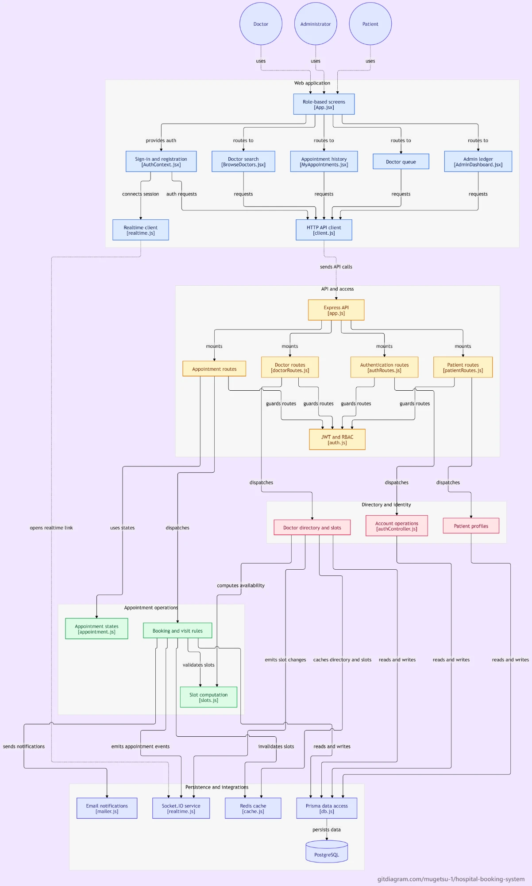

# Hospital Doctor Appointment Booking System

A full-stack web application for patient doctor discovery, appointment booking, and practice management.

## Architecture

## Features

- **Patient**: Register, search doctors, book slots, manage appointments
- **Doctor**: View queue, confirm/cancel bookings, complete consultations
- **Admin**: Manage doctors/patients, appointment ledger, user accounts

## Screenshots

| Register | Login |
| :---: | :---: |
|  |  |

| Doctor directory | Slot picker |
| :---: | :---: |
|  |  |

| Appointment history | Doctor queue |
| :---: | :---: |
|  |  |

| Admin overview | Admin ledger |
| :---: | :---: |
|  |  |

## Key Links

- **Lab Report**: [docs/LAB_REPORT.md](docs/LAB_REPORT.md)
- **Screenshots**: [screenshots/README.md](screenshots/README.md)
- **GitHub**: [Mugetsu-1/Hospital-Booking-System](https://github.com/Mugetsu-1/Hospital-Booking-System)
